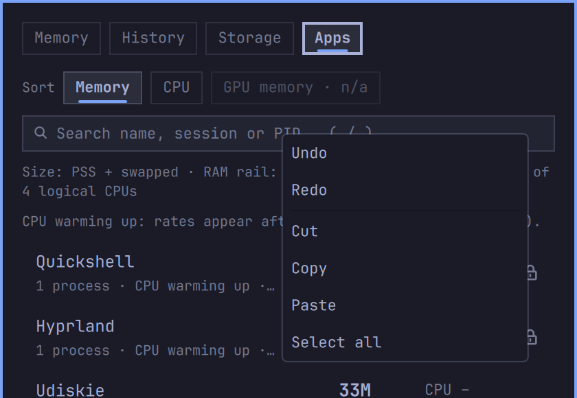
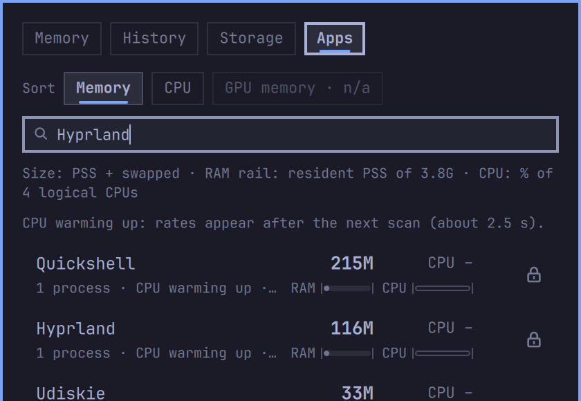

# Clipboard input verification — 0.2.1

Verified on 2026-10-11. Runtime and native fixture source:
`2427faaee1b741371fab2a8feb96c712c5c0aef9`.

A marketplace review identified Qt TextInput's automatic clipboard-content read
in Apps search and both Storage fields, including hidden forms. Field-length
validation happened after that read. RAMen now uses native plain TextEdit,
whose clipboard-change callback checks formats without reading contents, with
its own paste gestures and menu. Explicit reads use an owned worker with an
8192-byte cap, a one-second total deadline and the field's UTF-16 length limit.
Invalid or oversized paste is refused whole; it never truncates a folder path.

## Checks performed

- All nine JavaScript suites passed, including input validation and reply-stream
  isolation. All 290 Linux Python tests passed, with seven existing skips.
- Qt 6.8.2 offscreen behavior/render checks passed: 231 tests, no failures.
  Coverage includes native typing/selection/undo, Enter, Tab/Backtab, menu and
  middle-selection paste routing, field caps, caret scrolling, rejected-edit
  selection/undo, stale replies, focus/hide/restart cancellation and timeout.
  Existing Apps checks keep kill keys away from editors and details.
- Linux helper fixtures exercised invalid UTF-8, controls/line separators,
  oversized byte streams, UTF-16 caps, silent/dripping owners, exit deadlines,
  missing helpers, cancellation, owner EOF and orphaned helper descendants.
  Clipboard requests create no Storage cache or persistent clipboard data.
- In a disposable Try Omarchy 0.5.1 VM: Omarchy 4.0.4, Quickshell 0.3.1,
  Qt 6.11.2, Linux 7.2.8 aarch64, 4 CPUs / 4 GiB RAM. The original native
  fixtures compared three Qt TextFields with three replacements, including
  fields under a hidden parent. The window was active on Wayland and received
  the clipboard-change event; a foreign owner held its text pipe for 3.5 seconds
  and offered only 1024 bytes. The TextField control paused its event loop for
  **2007 ms**; RAMen's replacements kept their 100 ms timer within **110 ms**.
- That native driver also passed a Japanese/emoji preedit and commit, rejection
  of an oversized input-method edit with selection/undo preserved, and invocation
  of the custom menu's Paste through a recording transport. This isolates the
  gesture from Qt's native synchronous paste; backend budgets are tested above.
- A live installed RAMen in the Omarchy VM accepted keyboard and right-click
  menu paste through its actual shared runtime and Python worker. The Apps
  search field displayed the requested `Hyprland` text. The screenshots below
  are direct `grim` region captures at 2×, 840 × 580 pixels, of the panel's top.
  They are native captures, with no resampling or retouching. Their runtime
  source is `dbcccb3b4bb965fc4a22c87f9a32ab89af212432`; the subsequent caret
  cancellation change does not alter their appearance.

| Own menu | Paste received |
| --- | --- |
|  |  |

## Repeat the native regression

Only in a disposable, unlocked Wayland session, with the test window focused:

```sh
python3 scripts/check-input-clipboard.py --disposable-session
```

The checker needs C/C++, Qt 6 development headers/libraries, wayland-scanner,
libwayland-client, ext-data-control-v1 protocol XML and wl-copy. It installs
nothing. Generated protocol bindings, binaries and logs stay in ignored
`.agent-artifacts/input-clipboard/`; temporary binaries are removed on exit.
It deliberately replaces the session clipboard and cleans up its own process
groups. Disable a VM's host clipboard bridge before running it. The fixture
has a 12-second lifetime and a 1 MiB maximum even if given different arguments;
there is no unbounded stream or memory-exhaustion experiment.

## Scope and limits

The default Omarchy shell has other TextInput-based fields which can still
perform automatic clipboard reads. Full-shell IPC stalled with those present,
even after replacing RAMen's fields. The standalone native test isolates RAMen
and does not claim the host or other plugins are fixed. This patch does not
change Qt itself or those components.

The native input-method check injects Qt events; it is not a physical Japanese
keyboard/IME configuration test. The native menu transport fixture is a test
double; the separate live Apps paste used the actual helper. There was no new
hardware, GPU, multiple-monitor or suspend/resume QA in this patch. Previously
accepted [hardware coverage and limits](final-qa-evidence.md) and
[Storage 0.2 checks](storage-v02.md) keep their stated scopes.
