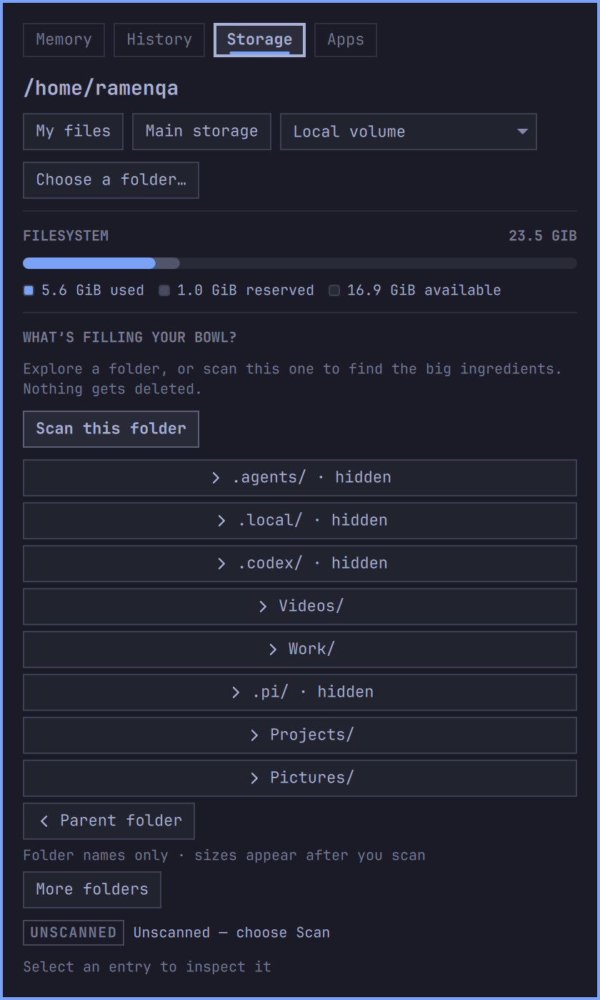
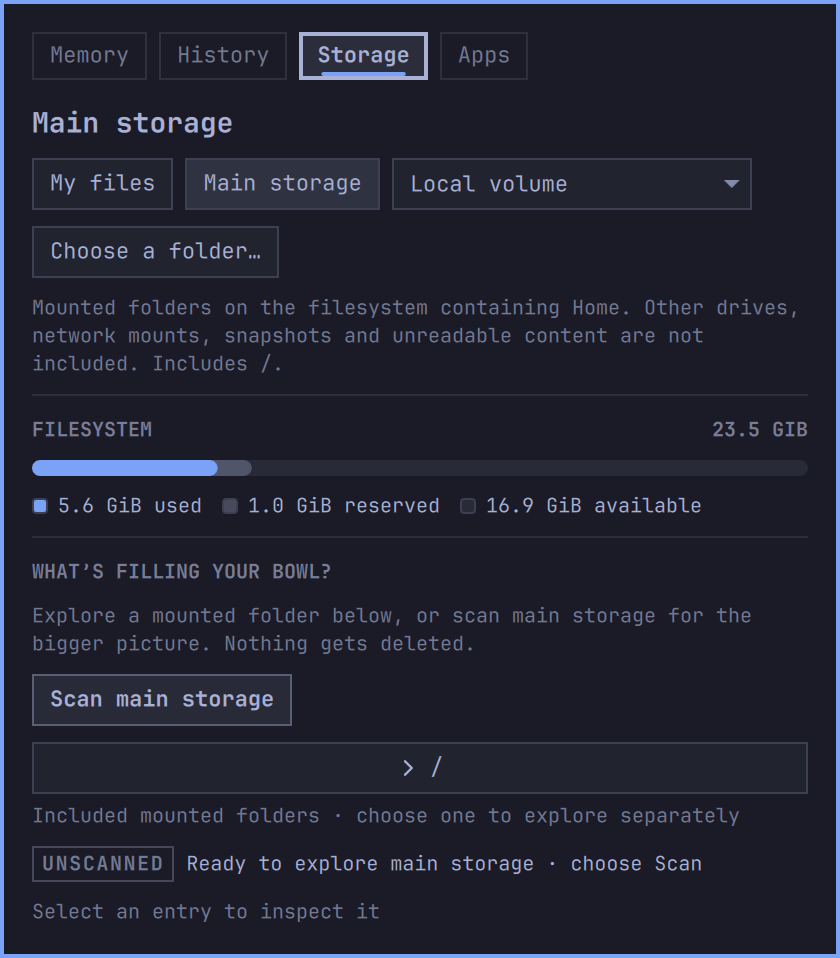
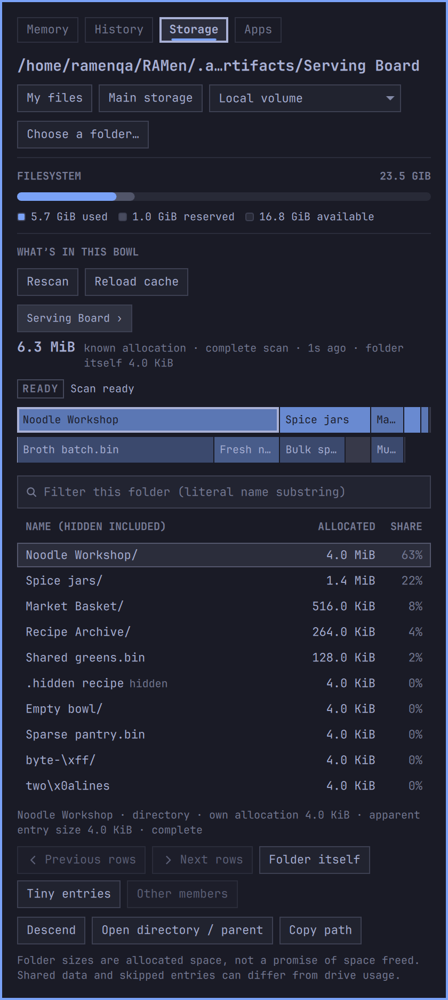
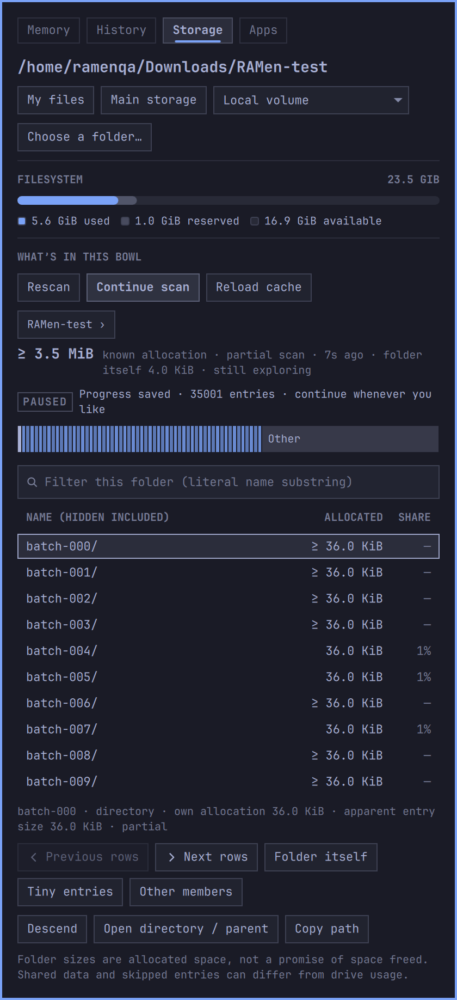
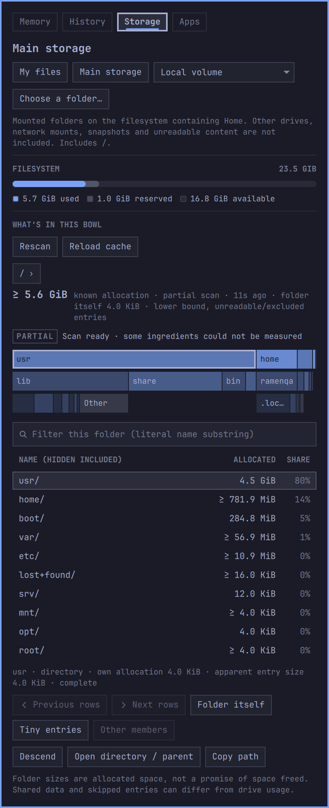

# Storage 0.2 native gallery

These are actual Wayland captures from RAMen running in the official
[Try Omarchy](https://github.com/omacom/try-omarchy) 0.5.1 VM on Apple Silicon.
The guest uses ext4, Omarchy runtime 4.0.4-1, Quickshell 0.3.1 and Qt 6.11.2.
Tokyo Night, 200% scale, 3840 × 2160 virtual display; panel width 420 logical
pixels. Runtime: `a26b5cb34108e3ae83f1dba9d816d56397eb18d3`, with the
manifest prepared for version 0.2.0.

| Start with your files | See what Main storage includes |
| --- | --- |
|  |  |

| A completed folder | Progress saved for later |
| --- | --- |
|  |  |



The disposable guest account is `ramenqa`. Home contains ordinary VM setup
folders; the Serving Board is original synthetic data made by
`scripts/storage-demo.py --fanout 60` beneath the repository's
`.agent-artifacts`, then moved to its shorter `Serving Board` path. It contains
119 measured entries and 6,615,040 allocated bytes, including sparse files,
hardlinks, hidden entries and names requiring byte escaping.

The paused example uses 100,000 empty test files in 100 directories under
`Downloads/RAMen-test`. This capture has 35,001 measured entries and 66 pending
folders. Continue completes at 100,101 entries. Main storage is the guest's
actual primary ext4 filesystem: 242,169 measured entries and 6,029,463,552
known allocated bytes. Partial coverage is displayed because some content
cannot be read or belongs to excluded mounts; it is not a physical-drive total.

## Capture method

Each master is a full-resolution `grim` capture from the running Hyprland
session. Public images are lossless `sips` crops of the plugin panel only,
without scaling, repainting, retouching or removing UI elements. Full desktop
masters remain in ignored task artifacts; upstream wallpaper and unrelated
windows are excluded by the panel crop. PNG hashes and exact crop rectangles
are recorded in [provenance.json](provenance.json).

For example, the completed folder crop uses:

```sh
grim ready-master.png
sips --cropToHeightWidth 1872 840 --cropOffset 62 2990 ready-master.png --out ready.png
```

`grim` runs inside the guest; `sips` runs on the macOS host. The crop offset is
in device pixels, with top 62 and left 2990. The source masters are 3840 × 2160.
These are native VM screenshots, separate from the Qt offscreen previews and
from earlier physical-hardware captures. See the
[verification record and limits](../../qa/storage-v02.md).
